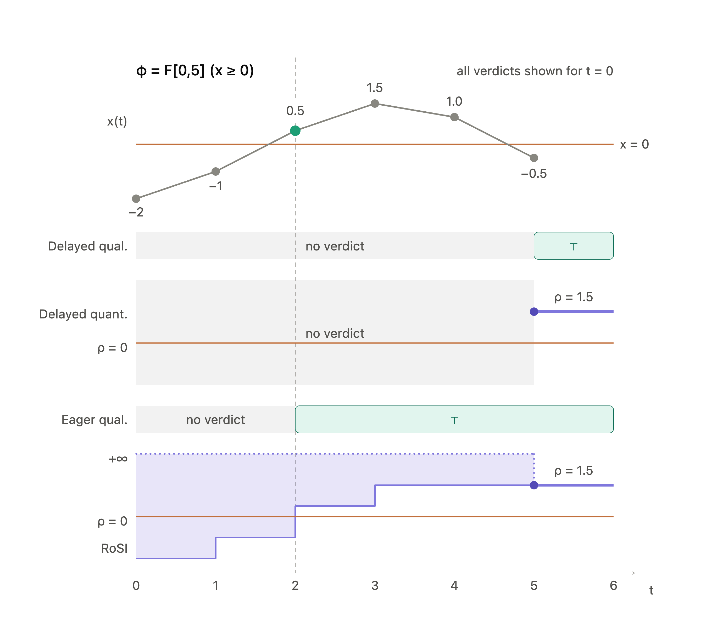

# Signal Temporal Logic and Evaluation Semantics

This page covers the logic mstlo monitors and the four online semantics it can evaluate it under. For how the monitor reads signals and when it emits verdicts, see [Implementation](implementation.md).

<!-- TOC -->

- [Signal Temporal Logic and Evaluation Semantics](#signal-temporal-logic-and-evaluation-semantics)
  - [Signal Temporal Logic (STL)](#signal-temporal-logic-stl)
  - [Evaluation Semantics](#evaluation-semantics)
    - [Visual Comparison](#visual-comparison)
    - [Delayed Qualitative](#delayed-qualitative)
    - [Delayed Quantitative](#delayed-quantitative)
    - [Robust Satisfaction Intervals (RoSI)](#robust-satisfaction-intervals-rosi)
    - [Eager Qualitative](#eager-qualitative)
  - [References](#references)

<!-- /TOC -->

## Signal Temporal Logic (STL)

Signal Temporal Logic (STL) [3] is a formalism for specifying properties of real-valued signals that evolve over time, providing a compact language to describe the desired behaviors of dynamic systems. STL evaluates properties over signals, which are defined as functions mapping a time domain (such as nonnegative real numbers, $\mathbb{R}_{\ge0}$) to a value domain.

mstlo focuses on bounded STL, meaning all temporal operators are constrained by finite time intervals of the form $[a, b]$, where $0 \le a < b$.

The core syntax of STL is built from a minimal set of primitive operators:

- **True ($\top$)**: The Boolean constant True.

- **Atomic Predicates ($\mu(x) < c$)**: Evaluates to True if the function over the signal is less than a constant $c$.

- **Negation ($\neg\varphi$)**: The logical NOT of a formula.

- **Conjunction ($\varphi \wedge \psi$)**: The logical AND of two formulas.

- **Until ($\varphi \mathcal{U}_{[a,b]} \psi$)**: States that $\varphi$ must hold continuously until $\psi$ becomes true within the time interval $[a, b]$.

From these primitives, the library derives other highly useful operators to simplify specifications:

- **Disjunction (OR)**: $\varphi \vee \psi$

- **Implication**: $\varphi \rightarrow \psi$

- **Eventually**: $\Diamond_{[a,b]}\varphi$

- **Globally**: $\Box_{[a,b]}\varphi$

## Evaluation Semantics

See also [semantics-comparison.ipynb](../mstlo-python/examples/semantics-comparison.ipynb) for an interactive demonstration of the different semantics.

An online monitor observes a system's behavior incrementally as discrete samples arrive. mstlo provides a unified interface supporting four distinct monitoring semantics, allowing users to trade off between expressiveness and verdict latency. In the following, we present the four semantics currently supported by mstlo.

All four semantics are evaluated over the signal prefix $x_{[0,i]}$, i.e. the samples observed up to the newest one at time $t_i$, read between samples through the configured [signal interpolation](implementation.md#signal-model). Each gives a verdict for a timestamp of interest $\tau$. When a formula reads several signals, each signal has its own newest sample, and $t_i$ in the rule for a predicate is the newest sample of the signal that predicate reads.

In all four semantics, verdicts are emitted in timestamp order: the monitor gives a verdict at $\tau$ only once every earlier timestamp has one, so the output can be read as a piecewise-constant signal. For the delayed semantics this holds by construction, since a prefix that covers $\tau + H(\varphi)$ covers the depth of every earlier timestamp as well. RoSI gives an interval for every timestamp as soon as it exists, and later refinements of an earlier timestamp may follow verdicts for later ones. Only under the eager semantics does the order change which verdicts can be given, see [Chronological Verdicts](#chronological-verdicts).

For the temporal operators, $I$ is an interval $[a,b]$ with $b>a \geq 0$, and $\tau + I = [\tau+a, \tau+b]$. The temporal depth $H(\varphi)$ of a formula is how far past $\tau$ its verdict at $\tau$ depends on the signal:

$$
H(\mu) = 0 \qquad H(\neg\varphi) = H(\varphi) \qquad H(\varphi_1 \circ \varphi_2) = \max(H(\varphi_1), H(\varphi_2)) \text{ for } \circ \in \{\land, \lor, \rightarrow\}
$$

$$
H(\Box_I \varphi) = H(\Diamond_I \varphi) = b + H(\varphi) \qquad H(\varphi \ \mathbf{U}_I\ \psi) = b + \max(H(\varphi), H(\psi))
$$

### Visual Comparison

Consider the evaluation of the formula $\varphi = \Diamond_{[0,5]}(x\geq 0)$ over the signal $x=[-2,-1,0.5,1.5,1.0,-0.5]$ for timestamps $t=[0,1,2,3,4,5]$. The formula has temporal depth $H(\varphi)=5$.

Focusing on the verdict for $\tau=0$, it is clear that we can say that $\varphi$ is satisfied at $t=2s$. The two delayed semantics can, however, only produce a verdict when the temporal depth has elapsed, i.e. at $t=5s$. The eager qualitative semantics is able to report satisfaction already at time $t=2s$. Similarly, RoSI semantics report the interval $[0.5,\infty]$ at time $t=2s$, and since the lower bound is positive and the interval encloses all possible future robustness values, this corresponds to satisfaction as well. RoSI converges at the delayed quantitative verdict $\rho=1.5$ at time $t=5s$.

This is illustrated in the figure below:

### Delayed Qualitative

The standard Boolean semantics of STL [3], where the monitor emits a strict true/false verdict only after observing enough of the signal (the temporal depth) to conclusively determine satisfaction or violation. The verdict at $\tau$ is given once the prefix covers $\tau + H(\varphi)$, i.e. $t_i \geq \tau + H(\varphi)$. Every value the rules refer to then lies inside the prefix, so the verdict is the same for every continuation of it. Formally, the semantics are defined as follows:

$$
⟦ \cdot ⟧ : \mathrm{Formula} \to (\mathrm{Signal} \times \mathbb{T}) \to \mathbb{B}
$$

$$
⟦ \mu ⟧(x_{[0,i]},\tau) = (x_{[0,i]}(\tau) \models \mu)
$$

$$
⟦ \neg \varphi ⟧ (x_{[0,i]},\tau) = \neg ⟦ \varphi ⟧ (x_{[0,i]},\tau)
$$

$$
⟦ \varphi_1 \land \varphi_2 ⟧(x_{[0,i]},\tau) = ⟦ \varphi_1 ⟧(x_{[0,i]},\tau) \land ⟦ \varphi_2 ⟧(x_{[0,i]},\tau)
$$

$$
⟦ \varphi_1 \lor \varphi_2 ⟧(x_{[0,i]},\tau) = ⟦ \varphi_1 ⟧(x_{[0,i]},\tau) \lor ⟦ \varphi_2 ⟧(x_{[0,i]},\tau)
$$

$$
⟦  \Box_I \varphi ⟧(x_{[0,i]},\tau) = \forall t' \in \tau + I.\ ⟦ \varphi ⟧(x_{[0,i]},t')
$$

$$
⟦ \Diamond_I \varphi ⟧(x_{[0,i]},\tau) = \exists t' \in \tau + I.\ ⟦ \varphi ⟧(x_{[0,i]},t')
$$

$$
⟦ \varphi \ \mathbf{U}_I\ \psi ⟧(x_{[0,i]},\tau) = \exists t' \in \tau + I.\ (⟦ \psi ⟧(x_{[0,i]},t') \land \forall t'' \in [\tau,t'].\ ⟦ \varphi ⟧(x_{[0,i]},t''))
$$

### Delayed Quantitative

The typical quantitative semantics of STL, as introduced by Donzé and Maler [1], computes a real-valued robustness score indicating the precise degree of satisfaction or violation. Similar to the qualitative mode, it requires full signal availability up to the temporal depth, i.e. the robustness at $\tau$ is given once $t_i \geq \tau + H(\varphi)$. It is defined as follows:

$$
\rho : \mathrm{Formula} \to (\mathrm{Signal} \times \mathbb{T}) \to \mathbb{R}
$$

$$
\rho(x_{[0,i]}, \tau, \mu_c) = c - \mu(x_{[0,i]}(\tau))
$$

$$
\rho(x_{[0,i]}, \tau, \neg\varphi)                 = -\rho(x_{[0,i]}, \tau, \varphi)
$$

$$
\rho(x_{[0,i]}, \tau, \varphi \wedge \psi)         = \min\left(\rho(x_{[0,i]}, \tau, \varphi), \rho(x_{[0,i]}, \tau, \psi)\right)
$$

$$
\rho(x_{[0,i]}, \tau, \varphi \vee \psi)           = \max\left(\rho(x_{[0,i]}, \tau, \varphi), \rho(x_{[0,i]}, \tau, \psi)\right)
$$

$$
\rho(x_{[0,i]}, \tau, \varphi \rightarrow \psi)    = \max\left(-\rho(x_{[0,i]}, \tau, \varphi), \rho(x_{[0,i]}, \tau, \psi)\right)
$$

$$
\rho(x_{[0,i]}, \tau, \Diamond_{I}\varphi)     = \max_{t' \in \tau+I} \rho(x_{[0,i]}, t', \varphi)
$$

$$
\rho(x_{[0,i]}, \tau, \Box_{I}\varphi)         = \min_{t' \in \tau+I} \rho(x_{[0,i]}, t', \varphi)
$$

$$
\rho(x_{[0,i]}, \tau, \varphi \ \mathbf{U}_I\ \psi) = \max_{t' \in \tau+I} \left(\min\left(\rho(x_{[0,i]}, t', \psi), \min_{t'' \in [\tau, t']} \rho(x_{[0,i]}, t'', \varphi)\right)\right)
$$

### Robust Satisfaction Intervals (RoSI)

As introduced by Deshmukh et al. [2], this semantics provides quantitative reasoning over partial traces. Instead of a single robustness value, the monitor computes an interval $[\rho_{min}, \rho_{max}]$ that encloses all possible future robustness values. A formula is definitively satisfied when $\rho_{min} > 0$ and definitively violated when $\rho_{max} < 0$. Formally, the semantics are defined as:

$$
[\rho] : \mathrm{Formula} \to (\mathrm{Signal} \times \mathbb{T}) \to \mathcal{I}(\mathbb{R})
$$

$$
[\rho](x_{[0,i]}, \tau, \mu_c)                    =
\begin{cases}
    [c - \mu(x_{[0,i]}(\tau)), c - \mu(x_{[0,i]}(\tau))] & \text{if } \tau \in [t_0, t_i] \\
    [-\infty, \infty]                                    & \text{otherwise}
\end{cases}
$$

$$
[\rho](x_{[0,i]}, \tau, \neg\varphi)                 = -[\rho](x_{[0,i]}, \tau, \varphi)
$$

$$
[\rho](x_{[0,i]}, \tau, \varphi \wedge \psi)         = \min([\rho](x_{[0,i]}, \tau, \varphi), [\rho](x_{[0,i]}, \tau, \psi))
$$

$$
[\rho](x_{[0,i]}, \tau, \varphi \vee \psi)           = \max([\rho](x_{[0,i]}, \tau, \varphi), [\rho](x_{[0,i]}, \tau, \psi))
$$

$$
[\rho](x_{[0,i]}, \tau, \varphi \rightarrow \psi)    = \max(-[\rho](x_{[0,i]}, \tau, \varphi), [\rho](x_{[0,i]}, \tau, \psi))
$$

$$
[\rho](x_{[0,i]}, \tau, \Diamond_{I}\varphi)     = \sup_{t' \in \tau + I} \left([\rho](x_{[0,i]}, t', \varphi)\right)
$$

$$
[\rho](x_{[0,i]}, \tau, \Box_{I}\varphi)         = \inf_{t' \in \tau + I} \left([\rho](x_{[0,i]}, t', \varphi)\right)
$$

$$
[\rho](x_{[0,i]}, \tau, \varphi \ \mathbf{U}_I\ \psi )  = \sup_{t' \in \tau + I} \min\left( [\rho](x_{[0,i]}, t', \psi), \inf_{t'' \in [\tau, t']} [\rho](x_{[0,i]}, t'', \varphi) \right)
$$

Where $\mathcal{I}(\mathbb{R})$ denotes the set of all intervals over the reals.

How RoSI intervals narrow as samples arrive is described in [Refinable Verdicts](implementation.md#refinable-verdicts).

### Eager Qualitative

Leverages the monotonicity in Boolean and temporal logic to emit early verdicts over partial traces. For example, a violation of a "globally" ($\Box$) property immediately yields a false verdict without waiting for the full interval to elapse, and satisfaction of an "eventually" ($\Diamond$) property yields a true verdict as soon as the condition is met. Unlike RoSI, it does not provide quantitative information and does not refine already given verdicts, and is thus significantly more efficient to compute. The semantics alter the delayed qualitative semantics to work over partial traces, by introducing a set of short-circuiting rules.

The rules evaluate to satisfied ($\top$), violated ($\bot$), or not yet decided ($?$). The monitor never outputs $?$: it emits `true` or `false` for a timestamp once the rules decide it, and a timestamp that is not yet decided simply has no verdict yet:

$$
⟦ \cdot ⟧ : \mathrm{Formula} \to (\mathrm{Signal} \times \mathbb{T}) \to \{\top, \bot, ?\}
$$

Since verdicts are emitted in [timestamp order](#evaluation-semantics), every formula $\varphi$ is decided on an interval $[t_0, t_\varphi]$ and undecided after it. We call $t_\varphi$ the frontier of $\varphi$. For a predicate $\mu$ it is the newest sample of the signal it reads, $t_\mu = t_i$. For any other formula, $t_\varphi$ is the largest $\tau$ such that the rule for $\varphi$ below decides every timestamp in $[t_0, \tau]$. In the rules, an operand is only read inside its frontier, where it is either $\top$ or $\bot$.

A predicate is decided wherever its signal has been observed:

$$
⟦ \mu ⟧(x_{[0,i]},\tau) =
\begin{cases}
    \top & \text{if } \tau \leq t_\mu \land x_{[0,i]}(\tau) \models \mu \\
    \bot & \text{if } \tau \leq t_\mu \land x_{[0,i]}(\tau) \not\models \mu \\
    ?    & \text{otherwise}
\end{cases}
$$

Negation swaps the two decided values:

$$
⟦ \neg\varphi ⟧(x_{[0,i]},\tau) =
\begin{cases}
    \top & \text{if } \tau \leq t_\varphi \land ⟦ \varphi ⟧(x_{[0,i]},\tau) = \bot \\
    \bot & \text{if } \tau \leq t_\varphi \land ⟦ \varphi ⟧(x_{[0,i]},\tau) = \top \\
    ?    & \text{otherwise}
\end{cases}
$$

A conjunction is violated as soon as one conjunct is, and a disjunction is satisfied as soon as one disjunct is, whether or not the other operand is known:

$$
⟦ \varphi_1 \land \varphi_2 ⟧(x_{[0,i]},\tau) =
\begin{cases}
    \bot & \text{if } \left(\tau \leq t_{\varphi_1} \land ⟦ \varphi_1 ⟧(x_{[0,i]},\tau) = \bot\right) \lor \left(\tau \leq t_{\varphi_2} \land ⟦ \varphi_2 ⟧(x_{[0,i]},\tau) = \bot\right) \\
    \top & \text{if } \tau \leq \min(t_{\varphi_1}, t_{\varphi_2}) \land ⟦ \varphi_1 ⟧(x_{[0,i]},\tau) = \top \land ⟦ \varphi_2 ⟧(x_{[0,i]},\tau) = \top \\
    ?    & \text{otherwise}
\end{cases}
$$

$$
⟦ \varphi_1 \lor \varphi_2 ⟧(x_{[0,i]},\tau) =
\begin{cases}
    \top & \text{if } \left(\tau \leq t_{\varphi_1} \land ⟦ \varphi_1 ⟧(x_{[0,i]},\tau) = \top\right) \lor \left(\tau \leq t_{\varphi_2} \land ⟦ \varphi_2 ⟧(x_{[0,i]},\tau) = \top\right) \\
    \bot & \text{if } \tau \leq \min(t_{\varphi_1}, t_{\varphi_2}) \land ⟦ \varphi_1 ⟧(x_{[0,i]},\tau) = \bot \land ⟦ \varphi_2 ⟧(x_{[0,i]},\tau) = \bot \\
    ?    & \text{otherwise}
\end{cases}
$$

$$
⟦ \varphi_1 \rightarrow \varphi_2 ⟧(x_{[0,i]},\tau) = ⟦ \neg\varphi_1 \lor \varphi_2 ⟧(x_{[0,i]},\tau)
$$

Globally is violated as soon as its operand is violated in the observed part of the window, and satisfied only once the operand is observed and satisfied on all of it. Eventually is the dual:

$$
⟦ \Box_I \varphi ⟧(x_{[0,i]},\tau) =
\begin{cases}
    \bot & \text{if } \exists t' \in [\tau+a, \min(t_\varphi, \tau+b)].\ ⟦ \varphi ⟧(x_{[0,i]},t') = \bot \\
    \top & \text{if } t_\varphi \geq \tau+b \land \forall t' \in \tau + I.\ ⟦ \varphi ⟧(x_{[0,i]},t') = \top \\
    ?    & \text{otherwise}
\end{cases}
$$

$$
⟦ \Diamond_I \varphi ⟧(x_{[0,i]},\tau) =
\begin{cases}
    \top & \text{if } \exists t' \in [\tau+a, \min(t_\varphi, \tau+b)].\ ⟦ \varphi ⟧(x_{[0,i]},t') = \top \\
    \bot & \text{if } t_\varphi \geq \tau+b \land \forall t' \in \tau + I.\ ⟦ \varphi ⟧(x_{[0,i]},t') = \bot \\
    ?    & \text{otherwise}
\end{cases}
$$

Until is satisfied as soon as a witness for $\psi$ is seen with $\varphi$ holding up to and including it. It is violated once every point of the window is ruled out as a witness, either because $\psi$ is observed to be violated there, or because $\varphi$ is observed to be violated at or before it:

$$
⟦ \varphi \ \mathbf{U}_I\ \psi ⟧(x_{[0,i]},\tau) =
\begin{cases}
    \top & \text{if } \exists t' \in [\tau+a, \min(t_\varphi, t_\psi, \tau+b)].\ \left(⟦ \psi ⟧(x_{[0,i]},t') = \top \land \forall t'' \in [\tau,t'].\ ⟦ \varphi ⟧(x_{[0,i]},t'') = \top\right) \\
    \bot & \text{if } \forall t' \in \tau + I.\ \left(\left(t' \leq t_\psi \land ⟦ \psi ⟧(x_{[0,i]},t') = \bot\right) \lor \exists t'' \in [\tau,\min(t', t_\varphi)].\ ⟦ \varphi ⟧(x_{[0,i]},t'') = \bot\right) \\
    ?    & \text{otherwise}
\end{cases}
$$

So an until without a witness stays undecided while some point of the window could still become one: $\psi$ is not yet observed there, and $\varphi$ has not been observed to fail before it.

In every rule the two decided cases are mutually exclusive, so their order does not matter.

#### Chronological Verdicts

The frontier is where timestamp order changes the verdicts. For a predicate it changes nothing, since a predicate is decided on all of $[t_0,t_i]$. It matters when a conjunction or disjunction over several signals is short-circuited by the signal that is ahead. Take $\Box_{[0,10]}((a > 0) \land (b > 0))$ with $a=[1,1,-1]$ at $t_a=[0,2,5]$ and $b=[1,1,1]$ at $t_b=[0,2,5]$:

| Input       | Verdicts emitted                   |
| ----------- | ---------------------------------- |
| $a=1$ at 0  | –                                  |
| $b=1$ at 0  | –                                  |
| $a=1$ at 2  | –                                  |
| $b=1$ at 2  | –                                  |
| $a=-1$ at 5 | –                                  |
| $b=1$ at 5  | 0: `false`, 2: `false`, 5: `false` |

At $a=-1$ the conjunction is violated at $5$, but it is undecided on $(2,5)$, where $a$ holds and $b$ is not known yet, so its frontier is $2$. The violation at $5$ therefore lies outside the frontier of the operand of $\Box$, and is not used until $b$ arrives.

#### Properties

- **Sound.** If the eager verdict at $\tau$ is not $?$, it equals the delayed qualitative verdict at $\tau$ for every continuation of the prefix.
- **Stable.** A decided verdict never changes as samples arrive; only $?$ is replaced. Each timestamp is therefore reported at most once, at the first update that decides it.
- **Never later than delayed.** Once every signal is observed up to $\tau + H(\varphi)$, the verdict at $\tau$ is decided.

## References

[1] A. Donzé and O. Maler, “Robust Satisfaction of Temporal Logic over Real-Valued Signals,” in Formal Modeling and
Analysis of Timed Systems, K. Chatterjee and T. A. Henzinger, Eds., Berlin, Heidelberg: Springer, 2010, pp. 92–106. doi:
[10.1007/978-3-642-15297-9_9.](https://doi.org/10.1007/978-3-642-15297-9_9)

[2] J. V. Deshmukh, A. Donzé, S. Ghosh, X. Jin, G. Juniwal, and S. A. Seshia, “Robust online monitoring of signal
temporal logic,” Form Methods Syst Des, vol. 51, no. 1, pp. 5–30, Aug. 2017, doi: [10.1007/s10703-017-0286-7.](https://doi.org/10.1007/s10703-017-0286-7)

[3] O. Maler and D. Nickovic, “Monitoring Temporal Properties of Continuous Signals,” in Formal Techniques, Modelling
and Analysis of Timed and Fault-Tolerant Systems, Y. Lakhnech and S. Yovine, Eds., Berlin, Heidelberg: Springer, 2004, pp. 152–166. doi: [10.1007/978-3-540-30206-3_12](https://doi.org/10.1007/978-3-540-30206-3_12).
